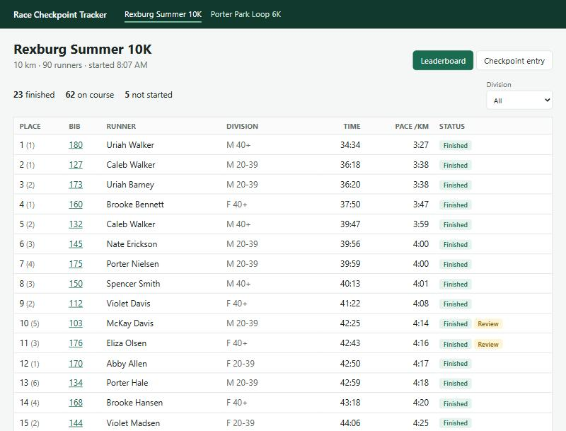

# Race Checkpoint Tracker

Volunteers at checkpoints type runners' bib numbers; the app turns those raw entries into live results for point-to-point and multi-lap loop courses. It's a rebuild of a Python (Tkinter) app I wrote at the City of Rexburg to track runners and checkpoint times across linear and circular routes, redone as a REST API in ASP.NET Core with an Angular front end.



**Skills:** C# / .NET 9, ASP.NET Core minimal APIs, REST design and ProblemDetails validation, Entity Framework Core, SQL Server, Angular 19 (standalone components, signals, RxJS), TypeScript, xUnit unit and integration tests (24), domain modeling.

## Run it

Requires the .NET 9 SDK, Node 20+, and SQL Server LocalDB.

```bash
cd src/race-tracker-ui && npm ci && npx ng build && cd ../..
dotnet test
dotnet run --project src/RaceTracker.Api --launch-profile http
```

Open http://localhost:5086. In Development the app creates two races already in progress, a 10K and a 4-lap loop, and a simulator records crossings as runners reach checkpoints, so the leaderboard moves while you watch. For front-end work, run `npx ng serve` in `src/race-tracker-ui`; it proxies `/api` to the running API.

## The interesting problem: what does an entry mean?

A volunteer's entry is just "bib 117 at the Pavilion at 9:14:02." What it *means* depends on everything else:

- **On a loop course, which lap is it?** The same checkpoint is crossed every lap. The calculator walks the runner's entries in time order and matches each to the next expected crossing of that checkpoint. If a lap-line entry is missing, the alternating pattern of checkpoints still places the later entries on the right laps, and the gap is reported.
- **Is it a duplicate?** Volunteers double-tap. A second entry for the same bib at the same checkpoint within 30 seconds is the same crossing.
- **Is it extra?** On a point-to-point course, the 2.5K can only be crossed once. A second crossing minutes later is flagged, not counted.
- **Did the runner skip a checkpoint?** A finisher with a missing checkpoint either cut the course or was missed by a volunteer. The app can't tell which, so it **flags the result for review instead of disqualifying anyone**, and the runner page shows exactly which checkpoint is missing.

### Raw entries are never edited
Splits are stored exactly as recorded. Lap assignment, duplicates, and placings are recalculated from the raw entries every time ([`ResultCalculator`](src/RaceTracker.Core/ResultCalculator.cs)). Correcting a mistake means deleting the bad entry (Undo), and every result updates consistently. The calculator is a pure function with no database or clock, which is why its 13 unit tests can pin down each rule exactly.

## Design decisions

- **Built for the volunteer at the checkpoint.** A big bib field that keeps focus, Enter to record, and an immediate reply showing the runner's name, so a mistyped bib is caught while the runner is still in view. An unregistered bib is rejected with a clear message and left in the field to correct. Undo is one click.
- **Contracts separate from entities.** The API returns DTOs ([`Contracts.cs`](src/RaceTracker.Api/Contracts.cs)), so the database schema can change without breaking the Angular client, and no request is ever bound straight onto an entity.
- **Validation as ProblemDetails.** Errors come back in the standard `application/problem+json` shape. The Angular client reads the first message out of it ([`problemMessage`](src/race-tracker-ui/src/app/race-api.ts)).
- **Live leaderboard without piling up requests.** The leaderboard polls every 5 seconds with RxJS `switchMap`, which cancels a slow request when a newer one starts, so results never arrive out of order.
- **One deployable.** `ng build` writes into the API's `wwwroot`, and the API serves the app with a fallback route for Angular deep links.

## Bugs found while testing in the browser

Every test passed, and these were still wrong in the running app. Each one now has a regression test:

1. **Every clock time was six hours off.** SQL Server returns `datetime2` values without a time zone, so the API sent `14:55:57` instead of `14:55:57Z`, and the browser read it as local time. Fixed with an EF Core value converter that marks stored times as UTC. I checked that the new test fails without the fix.
2. **Every runner's detail page said "place 1".** The endpoint ranked the runner against only themselves. Place has to come from the whole race.
3. **Enter-to-record relied on the browser's implicit form submission**, which my automated browser test couldn't trigger. The field now handles Enter explicitly (and blocks the implicit submit so it can't fire twice), and ignores repeats while a save is in progress, so a held key can't record a runner twice.

## Tests

`dotnet test` runs 24 tests:

- **Calculator (13):** linear and loop finishes, pace, out-of-order arrival, double taps, entries before the gun, extra crossings, lap assignment around a missed entry, ranking order, ties sharing a place, division places
- **API (11, real HTTP pipeline on SQLite):** recording, validation problems, future times, duplicate warnings, results and filters, undo, runner detail, UTC serialization, 404s

## What I'd add for a real event
- Offline entry on the checkpoint screen (queue in IndexedDB, sync when the signal returns), since parks don't always have coverage.
- Sign-in per volunteer and per checkpoint, with an audit trail of who deleted what.
- Chip-timing import, and CSV export of official results.

Built with AI assistance (Claude Code). I set the requirements from the original app, designed the result rules and test cases, and tested the volunteer and leaderboard flows in the browser, which is where the three bugs above surfaced.
